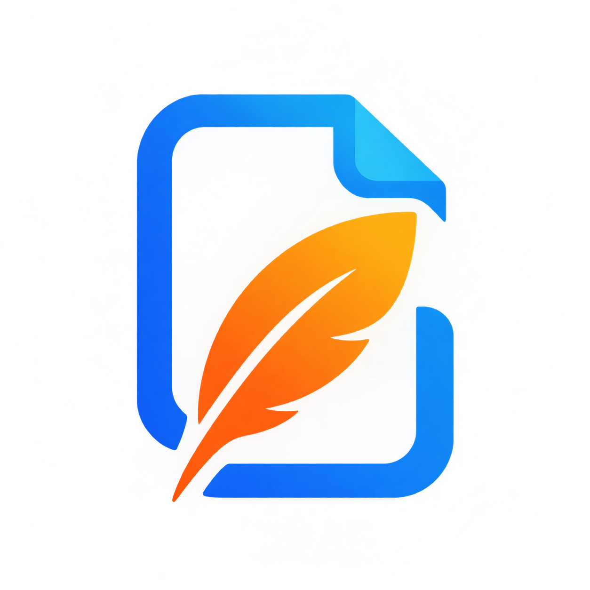

# <div style="display: flex; flex-direction: row; align-items: center; align-content: center;" >  LightFiles </div>

Легкий self-hosted файлообменник: загрузил файл — получил ссылку — скинул кому надо. Без облаков, без логинов в чужих
сервисах.

Моя запущенная версия:
https://files.old.numerum.team/

## Зачем это

Мне регулярно нужно быстро перекинуть файл на несколько компьютеров. Каждый раз одно и то же: либо заливаешь в облако и
возишься со ссылками, либо заходишь на чужом компьютере в свой аккаунт (а потом не забываешь выйти — и вот это «не
забываешь» напрягает больше всего).

LightFiles решает ровно эту задачу: свой сервер, свой домен, публичная ссылка на файл. Захотел — ограничил доступ
логином, захотел — оставил открытым. Никаких сторонних аккаунтов.
  
Проект писался для себя и для практики, поэтому не претендует на роль production-ready решения на миллион пользователей.
Но работает.

## Стек
* Python 3.14
* Quart — ASGI-форк Flask от той же команды Pallets
* Hypercorn — ASGI-сервер
* SQLAlchemy 2.x (async) + aiosqlite
* quart-auth, quart-wtforms
* Bootstrap 6 (ESM-сборка) + Resumable.js на клиенте

## Установка
```bash
git clone https://github.com/AndreiDuvakin/LightFilesFlask.git
cd LightFilesFlask

python -m venv .venv
source .venv/bin/activate

pip install poetry
poetry install
```

## Настройка
Создайте .env в корне проекта или задайте переменные окружения:  
```text
SECRET_KEY=change-me-to-something-random
UPLOAD_FOLDER=uploads

PREFIX=
DEBUG=true
HOST=localhost
PORT=6767
DB=db.sqlite3

MAX_CONTENT_LENGTH=17179869184
```

## Запуск
```bash
python -m app.main
```

## Контакты

По любым вопросам вы можете написать мне:  
Email:   
* [andrei@duvakin.ru](mailto:andrei@duvakin.ru)
* [andreiduvakin@gmail.com](mailto:andreiduvakin@gmail.com)  

Сайт:
[https://andrei.numerum.team/](https://andrei.numerum.team/)

## Лицензия

Проект распространяется под лицензией MIT. См. файл [LICENSE](LICENSE).

Лицензия MIT также предусматривает предоставление программного обеспечения
«как есть», без гарантий.